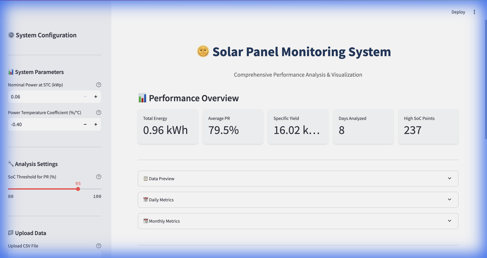
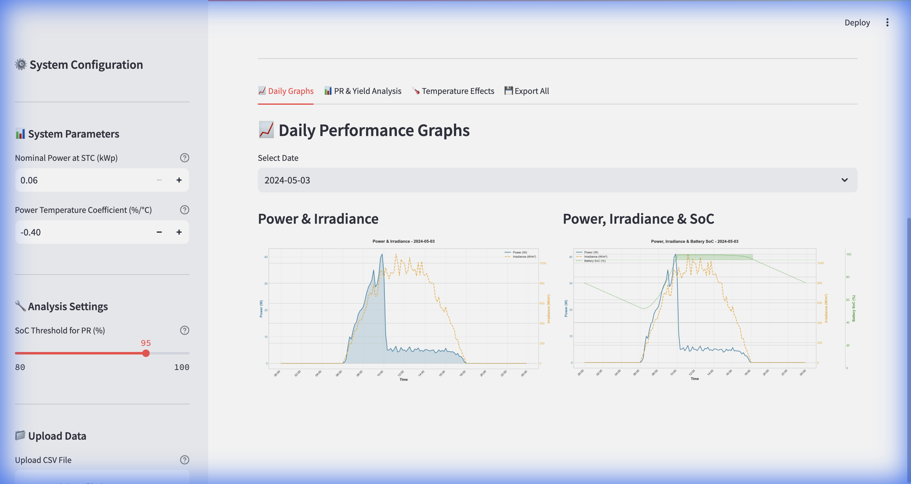
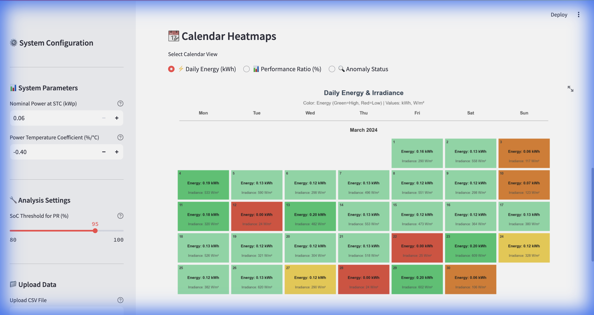
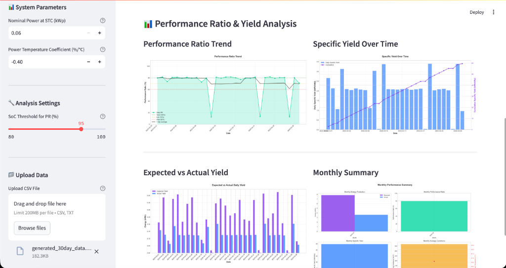
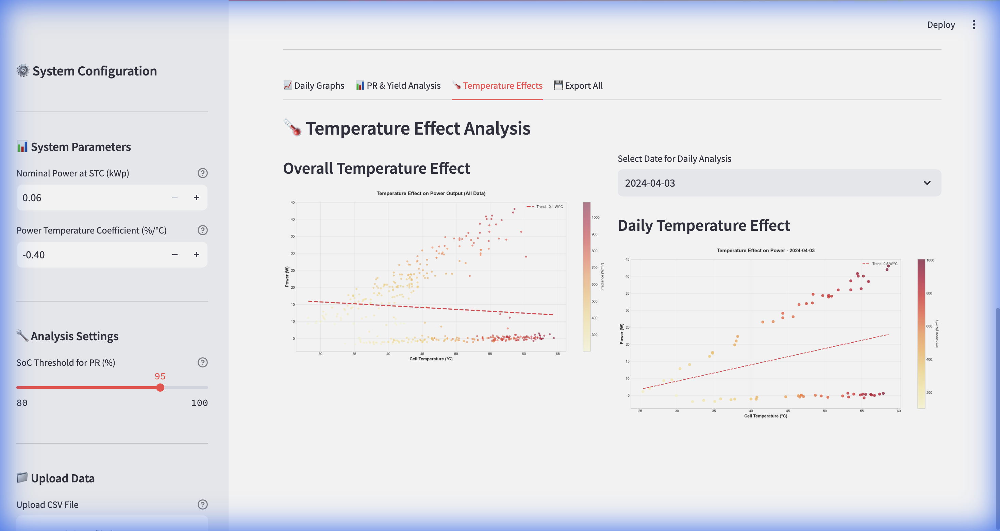

# 🌞 Solar Panel Monitoring System

A comprehensive web-based application for analyzing solar panel performance with real-time data visualization, anomaly detection, and calendar view.

## ✨ Features

### 📊 Data Analysis
- **Real-time Performance Metrics**: Monitor power output, performance ratio, and specific yield
- **Daily & Monthly Aggregation**: Automatic computation of daily and monthly statistics
- **Expected Power Calculation**: Compare actual vs theoretical maximum output
- **Temperature Correction**: Automatic temperature coefficient adjustments

### 📈 Visualizations
- **Daily Graphs**: Power & Irradiance, Voltage & Irradiance, Current & Irradiance
- **Performance Ratio Trends**: Track PR over time with anomaly detection
- **Temperature Effects**: Analyze temperature impact on performance
- **Monthly Summary Charts**: Comprehensive monthly performance overview

### 📅 Calendar View
- **Color-coded Daily Energy**: Visual calendar showing energy production
- **Dual-metric Display**: Shows both energy (kWh) and irradiance (W/m²)
- **Anomaly Highlighting**: Instantly identify problematic days
- **Dynamic Sizing**: Only shows rows with actual data - no wasted space

### 🔍 Anomaly Detection
- **Automatic Detection**: Rule-based anomaly identification
  - Low PR Detection (PR < 60%)
  - Zero Energy Alerts
  - Low Energy Days
- **Severity Levels**: Critical, Warning, Normal
- **Visual Indicators**: Color-coded alerts in calendar and summary cards
- **Detailed Reports**: Anomaly history with dates and details

### 💾 Export Capabilities
- **Graph Export**: Save all daily and monthly graphs as PNG
- **Data Export**: Export processed metrics to CSV
- **ZIP Archive**: Bulk download all exports
- **Organized Structure**: Auto-organized by date and type

## 🚀 Quick Start

### Prerequisites
- Python 3.8 or higher
- pip package manager

### Installation

1. **Clone the repository**
```bash
git clone https://github.com/YOUR_USERNAME/solar-monitoring.git
cd solar-monitoring
```

2. **Install dependencies**
```bash
pip install -r requirements.txt
```

3. **Run the application**
```bash
streamlit run app.py
```

The application will open in your browser at `http://localhost:8501`

## 📋 Data Format

The application accepts CSV files with the following columns:

| Column | Description | Unit |
|--------|-------------|------|
| Timestamp | Date and time | Various formats supported |
| DC Current (A) | Solar panel current | Amperes |
| DC Voltage (V) | Solar panel voltage | Volts |
| Irradiance (W/m2) | Solar irradiance (optional) | W/m² |
| Cell Temperature (C) | Module temperature (optional) | °C |
| Battery SoC (%) | State of charge (optional) | % |

### Supported Date Formats
- `YYYY-MM-DD HH:MM:SS`
- `D/M/YYYY H:MM`
- Auto-detects format

### Sample Data
A sample data generator is included:
```bash
python generate_sample_data.py
```

## 🛠️ Configuration

### System Settings (Sidebar)
- **Nominal Power**: System rated power (kW)
- **Temperature Coefficient**: Power temperature coefficient (%/°C)
- **High SoC Threshold**: Battery curtailment threshold (%)

## 📊 Key Metrics Explained

### Performance Ratio (PR)
```
PR = (Actual Energy / Expected Energy) × 100%
```
Good systems achieve 75-85% PR.

### Specific Yield
```
Specific Yield = Daily Energy / Nominal Power (kWh/kWp)
```

### Average Irradiance
Calculated only for **daytime hours (6 AM - 6 PM)** to avoid nighttime zeros artificially lowering the average.

## 🗂️ Project Structure

```
solar-monitoring/
├── app.py                      # Main Streamlit application
├── modules/
│   ├── data_parser.py         # Data parsing and validation
│   ├── calculations.py        # Performance calculations
│   ├── visualizations.py      # Graph generation
│   └── export.py              # Export functionality
├── sample_data/               # Sample data files
├── exports/                   # Generated exports (gitignored)
├── docs/                      # Documentation
├── requirements.txt           # Python dependencies
├── USER_GUIDE.md             # Detailed user guide
└── README.md                  # This file
```

## 📖 Documentation

- **[User Guide](USER_GUIDE.md)**: Comprehensive usage documentation
- **[User Guide (PDF)](🌞%20Solar%20Panel%20Monitoring%20System%20-%20User%20Guide.pdf)**: Printable PDF version

## 🎨 Screenshots

### Main Dashboard


### Daily Performance Graphs


### Calendar View (New Feature!)

*Color-coded calendar showing daily energy production (kWh) and irradiance (W/m²) with anomaly detection*

### PR Analysis


### Temperature Effects


## 🔧 Technology Stack

- **Frontend**: Streamlit
- **Data Processing**: Pandas, NumPy
- **Visualization**: Matplotlib, Seaborn
- **Export**: Standard Python libraries

## 🤝 Contributing

Contributions are welcome! Please feel free to submit a Pull Request.

## 📝 License

This project is licensed under the MIT License - see the LICENSE file for details.

## 👤 Author

Created for solar PV system monitoring and analysis.

## 🙏 Acknowledgments

- Built with Streamlit
- Visualization powered by Matplotlib
- Data processing with Pandas

## 📞 Support

For issues and questions, please open an issue on GitHub.

---

**Note**: This application is designed for monitoring and analysis purposes. Always verify critical decisions with professional solar PV expertise.
