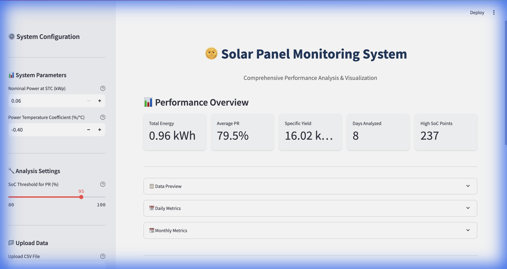
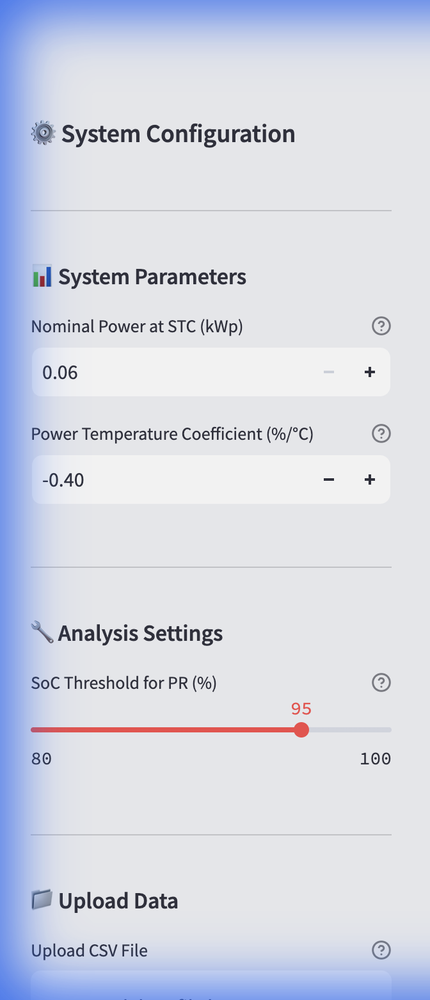
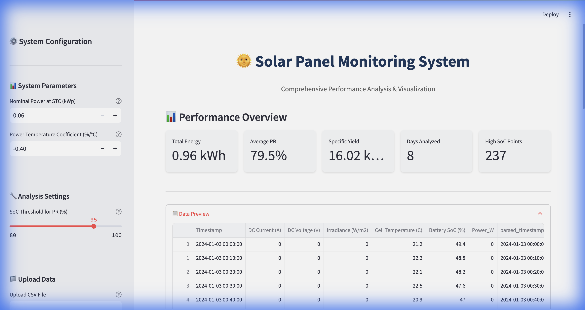
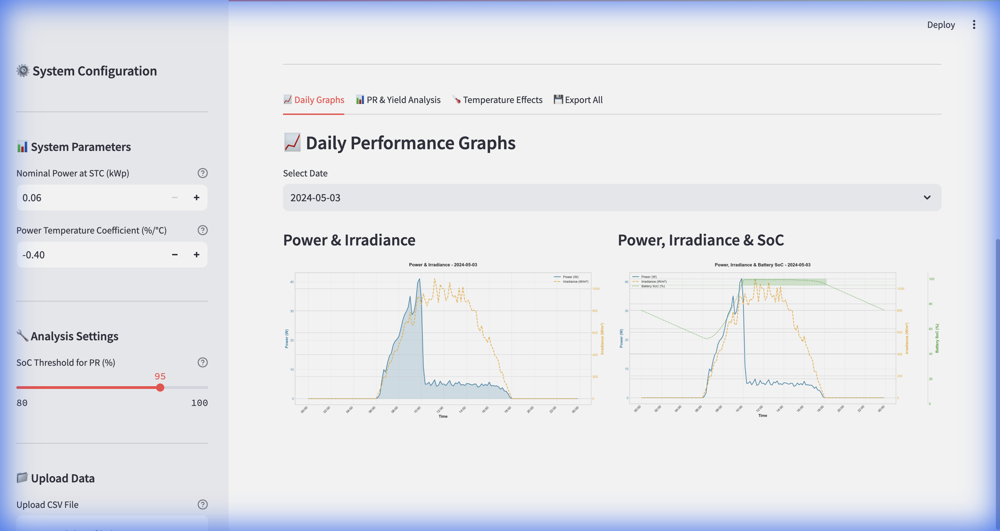
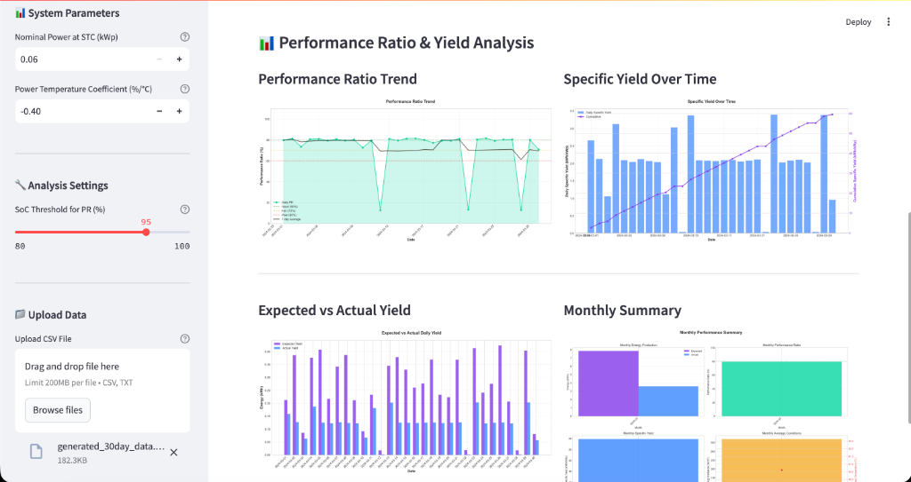
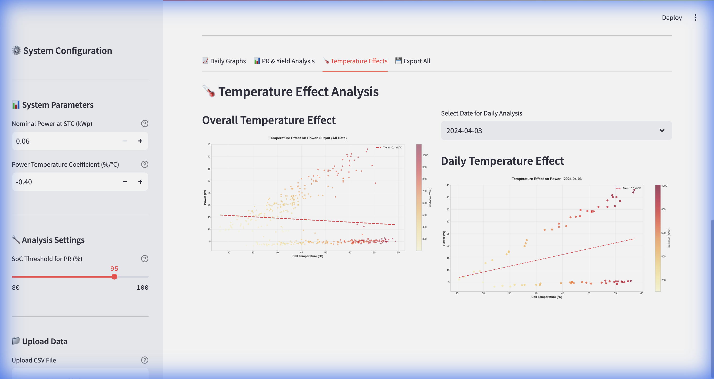

# 🌞 Solar Panel Monitoring System
## User Guide & Documentation

**Version 1.0** | January 2026

---

# Table of Contents

1. [Introduction](#1-introduction)
2. [Getting Started](#2-getting-started)
3. [System Configuration](#3-system-configuration)
4. [Uploading Your Data](#4-uploading-your-data)
5. [Understanding the Dashboard](#5-understanding-the-dashboard)
6. [Daily Performance Analysis](#6-daily-performance-analysis)
7. [Monthly Performance Analysis](#7-monthly-performance-analysis)
8. [Calendar View](#8-calendar-view)
9. [Custom Range Analysis](#9-custom-range-analysis)
10. [Performance Ratio & Yield Analysis](#10-performance-ratio--yield-analysis)
11. [Temperature Effect Analysis](#11-temperature-effect-analysis)
12. [Data Quality Analysis](#12-data-quality-analysis)
13. [Exporting Data & Reports](#13-exporting-data--reports)
14. [Integrating Weather Data](#integrating-weather-data)
15. [Understanding Key Metrics](#15-understanding-key-metrics)
16. [Data Format Requirements](#16-data-format-requirements)
17. [Troubleshooting](#17-troubleshooting)
18. [Glossary](#18-glossary)

---

# 1. Introduction

## What is the Solar Panel Monitoring System?

The **Solar Panel Monitoring System** is a professional-grade web application designed to help solar panel owners, installers, and engineers analyze the performance of photovoltaic (PV) systems. Whether you have a small residential setup or a commercial installation, this tool provides comprehensive insights into your solar energy production.

### Key Benefits

| Benefit | Description |
|---------|-------------|
| **Performance Tracking** | Monitor daily and monthly energy production |
| **Efficiency Analysis** | Calculate Performance Ratio (PR) to understand system efficiency |
| **Problem Detection** | Identify underperformance through Expected vs. Actual comparisons |
| **Temperature Impact** | Understand how heat affects your panel efficiency |
| **Battery Awareness** | Filter data when batteries are full for accurate PR calculations |
| **Professional Reports** | Export high-resolution graphs for documentation |

### Who Should Use This System?

- **Solar Panel Owners** – Track your investment's performance
- **Solar Installers** – Validate installations and diagnose issues
- **Energy Auditors** – Generate professional performance reports
- **Researchers** – Analyze solar data for studies and optimization

---

# 2. Getting Started

## Accessing the Application

Open your web browser and navigate to the application URL:

```
http://localhost:8501
```

You will see the main dashboard interface:



The interface consists of two main areas:
- **Left Sidebar** – System configuration and data upload
- **Main Content Area** – Performance metrics, graphs, and analysis

---

# 3. System Configuration

Before analyzing your data, you need to configure your solar system parameters. These settings are located in the **left sidebar**.



## 3.1 System Parameters

### Nominal Power at STC (kWp)

This is your solar system's **rated power output** under Standard Test Conditions.

| Field | Description |
|-------|-------------|
| **What to Enter** | Your panel/system's nameplate power rating |
| **Unit** | Kilowatt-peak (kWp) |
| **Allowed Range** | 0.001 to 1000 kWp |
| **Example** | For a 48W panel, enter `0.048` |

> [!TIP]
> **How to Find This Value**: Check your solar panel's datasheet or label. Look for "Pmax" or "Nominal Power" at STC (1000 W/m², 25°C).

### Power Temperature Coefficient (%/°C)

This value represents how much your panel's power output decreases as temperature rises above 25°C.

| Field | Description |
|-------|-------------|
| **What to Enter** | Temperature coefficient from your panel's datasheet |
| **Unit** | Percentage per degree Celsius |
| **Typical Range** | -0.30% to -0.50% for silicon panels |
| **Example** | Enter `-0.40` for a -0.40%/°C coefficient |

> [!NOTE]
> **Negative Value**: This value is always negative because panels produce less power at higher temperatures.

## 3.2 Analysis Settings

### SoC Threshold for PR (%)

This setting controls how the system handles data when your **battery is nearly full**.

| Field | Description |
|-------|-------------|
| **Default Value** | 95% |
| **Range** | 80% to 100% |
| **Purpose** | Exclude data points from Performance Ratio calculation when battery is full |

> [!IMPORTANT]
> **Why This Matters**: When your battery reaches high State of Charge (SoC), the solar system often **curtails (reduces) power generation** to protect the battery. Including this curtailed data in PR calculations would incorrectly suggest poor performance. The system automatically excludes these periods from PR calculations while still including them in total energy counts.

---

# 4. Uploading Your Data

The system accepts solar monitoring data in **CSV format**. You have two options for providing data:

## 4.1 Upload a CSV File

1. In the sidebar, locate the **"Upload CSV File"** section
2. Click **"Browse files"** or drag and drop your CSV file
3. Wait for the file to be processed

## 4.2 Paste Data Directly

If you have data in a spreadsheet or text file:

1. Scroll down in the sidebar to **"Or paste data directly"**
2. Copy your CSV data (including headers)
3. Paste into the text area
4. The system will automatically detect your data

## 4.3 Process Your Data

After uploading or pasting data:

1. Click the **"🚀 Process Data"** button
2. Wait for the system to analyze your data
3. View the **Column Detection Results** to confirm all columns were identified correctly

### Column Detection Confirmation

The system will display detection results:

| Status | Meaning |
|--------|---------|
| ✅ Detected 'Column Name' as type | Column successfully identified |
| ⚠️ Could not detect type column | Column not found (optional columns may be missing) |
| 🔄 Detected mV, converting to V | Automatic unit conversion applied |
| 📊 Data frequency: ~X minutes | Data interval detected |

## 14. Integrating Weather Data

If your uploaded data lacks **Irradiance** or **Temperature** readings, or if you want to compare against satellite data, you can fetch historical weather data from Open-Meteo.

1.  **Locate "Weather Data"** in the sidebar (below the Process button).
2.  **Enter Location**:
    *   **Option A: Google Maps URL**: Paste a URL (e.g., from your browser address bar) and click **"📍 Parse URL"**.
    *   **Option B: Lat/Lon**: Manually enter Latitude and Longitude.
3.  Click **"☁️ Fetch Weather Data"**.
4.  The system will:
    *   Retrieve hourly historical data for your data's date range.
    *   Resample it to match your data frequency (e.g., 10-min intervals).
    *   Merge it into your analysis (filling gaps or adding new columns).

---

# 5. Understanding the Dashboard

Once your data is processed, the dashboard displays key performance metrics.


## 5.1 Performance Overview Cards

The top section displays five key performance indicators:

| Metric | Description | Good Values |
|--------|-------------|-------------|
| **Total Energy** | Total electricity generated (kWh) | Higher is better |
| **Average PR** | Average Performance Ratio across all days | 75-85% typical for well-performing systems |
| **Specific Yield** | Energy per installed capacity (kWh/kWp) | Varies by location; 3-6 kWh/kWp/day typical |
| **Days Analyzed** | Number of days in your dataset | Based on your data |
| **High SoC Points** | Data points where battery was ≥95% full | These are excluded from PR calculation |

## 5.2 Data Preview Section

Expand the **"Data Preview"** section to see your raw data with calculated fields:



The table shows:
- **Timestamp** – Date and time of each reading
- **DC Current (A)** – Measured current from panels
- **DC Voltage (V)** – Measured voltage from panels  
- **Irradiance (W/m²)** – Solar radiation intensity
- **Cell Temperature (°C)** – Panel surface temperature
- **Battery SoC (%)** – Battery charge level
- **Power_W** – Calculated power (Current × Voltage)
- **parsed_timestamp** – Standardized timestamp for analysis

## 5.3 Daily and Monthly Metrics

Expand these sections to view aggregated data tables:

- **Daily Metrics** – One row per day with energy, PR, and statistics
- **Monthly Metrics** – One row per month with aggregated values

---

# 6. Daily Performance Analysis

Navigate to the **📈 Daily Graphs** tab to view detailed daily performance charts.



## 6.1 Selecting a Date

Use the **"Select Date"** dropdown to choose which day's data to visualize. Each day has its own separate graphs.

## 6.2 Power & Irradiance Graph

This chart shows the relationship between solar radiation and your system's power output throughout the day.

| Line Color | Metric | Description |
|------------|--------|-------------|
| **Blue** | Power (W) | Your system's actual power output |
| **Orange (dashed)** | Irradiance (W/m²) | Solar radiation hitting the panels |

**What to Look For:**
- Power should follow irradiance pattern (both peak around midday)
- Gaps or drops may indicate shading, clouds, or equipment issues
- Maximum power typically occurs at maximum irradiance

## 6.3 Power, Irradiance & SoC Graph

This three-way chart adds battery state-of-charge to the analysis.

| Line | Metric | Description |
|------|--------|-------------|
| **Blue** | Power (W) | System power output |
| **Orange (dashed)** | Irradiance (W/m²) | Solar radiation |
| **Green (dotted)** | Battery SoC (%) | Battery charge level |

**What to Look For:**
- **SoC Rising**: Battery is charging
- **SoC at 95%+**: System may be curtailing (reducing) power output
- **SoC Dropping at Night**: Normal battery discharge

> [!NOTE]
> The horizontal line at 95% marks the threshold above which data is excluded from PR calculations.

---

---
# 7. Monthly Performance Analysis

Navigate to the **📊 Monthly Graphs** tab to view hourly averaged performance for an entire month.

## 7.1 Understanding Hourly Averages
These graphs show the **average behavior** of your system at each hour of the day across all days in the selected month.
*   **Example**: The data point at 12:00 PM represents the average of all 12:00 PM readings in that month.
*   **Use Case**: Identifies consistent shading issues (e.g., a tree casting a shadow every day at 3 PM) or orientation problems.

## 7.2 Available Monthly Graphs
*   **Avg Power & Irradiance**: Typical daily profile for the month.
*   **Avg Voltage & Irradiance**: See how voltage drifts with seasonal temperature changes.
*   **Avg Current & Irradiance**: Analyze current generation patterns.

---

# 8. Calendar View

Navigate to the **📅 Calendar View** tab for a bird's-eye view of your system's performance.

## 8.1 Performance Heatmaps
Visualize metrics across a calendar grid to spot trends or outages.
*   **Select Metric**: Choose between **Energy** (kWh), **Performance Ratio** (%), or **Anomaly Status**.
*   **Color Coding**:
    *   **Energy**: Darker green = Higher energy.
    *   **PR**: Green (Good), Yellow (Fair), Red (Poor).
    *   **Anomaly**: Green (Normal), Red (Critical Issue).

## 8.2 Anomaly Detection
The system automatically scans each day for issues:
*   **Critical Days (Red)**: Very low PR (<60%) or Zero Energy.
*   **Warning Days (Yellow)**: Low PR (60-70%) or unexpected drops.
*   **Normal Days (Green)**: System performing within expected parameters.

---

# 9. Custom Range Analysis

Navigate to the **📆 Custom Range** tab to analyze specific periods (e.g., a specific week of bad weather).

## 9.1 Analyzing Non-Standard Periods
Select any **Start Date** and **End Date** to generate averaged graphs for that specific window.
*   **Flexible Analysis**: Compare a rainy week vs. a sunny week.
*   **aggregated Metrics**: See total energy and average PR for just that period.

---

# 10. Performance Ratio & Yield Analysis

Navigate to the **📊 PR & Yield Analysis** tab for long-term performance trends.



## 7.1 Performance Ratio Trend

This chart shows how your system's efficiency changes over time.

**Key Elements:**
- **Teal Line** – Daily PR values
- **Black Line** – 7-day rolling average (smoothed trend)
- **Green Dashed Line (80%)** – Good performance threshold
- **Orange Dashed Line (70%)** – Fair performance threshold
- **Red Dashed Line (60%)** – Poor performance threshold

**Interpreting Results:**

| PR Range | Performance Level | Action |
|----------|------------------|--------|
| 80%+ | Excellent | System performing optimally |
| 70-80% | Good | Normal operation |
| 60-70% | Fair | Investigate potential issues |
| Below 60% | Poor | Immediate inspection recommended |

## 7.2 Specific Yield Over Time

Shows energy production per unit of installed capacity.

| Element | Description |
|---------|-------------|
| **Blue Bars** | Daily specific yield (kWh/kWp) |
| **Purple Line** | Cumulative specific yield |

**What Good Looks Like:**
- Consistent daily bars (accounting for weather)
- Steady upward cumulative line
- Higher values in summer months

## 7.3 Expected vs. Actual Yield

Compares what your system **should have produced** (based on sunlight and temperature) against **actual production**.

| Bar Color | Meaning |
|-----------|---------|
| **Purple** | Expected Energy – Theoretical maximum based on conditions |
| **Blue** | Actual Energy – What your system actually produced |

**Interpreting Results:**
- Bars should be close to each other
- Large gaps suggest equipment issues, shading, or soiling
- Actual exceeding expected is unusual but possible with conservative estimates

## 7.4 Monthly Summary

Four-panel summary showing:
1. **Monthly Energy Production** – Expected vs. Actual
2. **Monthly Performance Ratio** – Efficiency by month
3. **Monthly Specific Yield** – Production per capacity
4. **Monthly Average Conditions** – Irradiance and temperature trends

---

---

# 11. Temperature Effect Analysis

Navigate to the **🌡️ Temperature Effects** tab to understand how heat impacts your panels.



## 8.1 Overall Temperature Effect

This scatter plot shows power output vs. cell temperature for your entire dataset.

**Chart Elements:**
- Each **dot** represents one data reading
- **Color gradient** indicates irradiance (yellow/red = higher irradiance)
- **Trend line** shows the overall temperature effect

**What to Look For:**
- Downward slope confirms power decreases at higher temperatures
- The trend line slope indicates your actual temperature coefficient
- Scattered points at similar temperatures may indicate other factors

## 8.2 Daily Temperature Effect

Select a specific date to see temperature effects for that day only. This helps identify:
- Morning vs. afternoon performance differences
- Temperature-related afternoon power drops
- Cooling effects from wind or weather changes

---

---

# 12. Data Quality Analysis

Navigate to the **📋 Data Quality** tab to audit the health of your dataset.

## 12.1 Data Completeness
Checks if you are missing data points.
*   **Expected Points**: Based on your data frequency (e.g., 144 points/day for 10-min data).
*   **Actual Points**: How many readings were actually recorded.
*   **Completeness %**: (Actual / Expected) × 100. Lower values indicate logger downtime.

## 12.2 Value Range Checks
Verifies if readings are within physical limits:
*   **Voltage**: Should not exceed system Vmax (e.g., 600V).
*   **Irradiance**: Should not exceed solar constant markedly (>1300 W/m²).
*   **Temperature**: Should be within realistic bounds (-20°C to 80°C).

---

# 13. Exporting Data & Reports

Navigate to the **💾 Export Options** section to generate customized reports and data. The interface is divided into two tabs: **📊 Graph Export** and **📝 Data Export**.

## 9.1 Graph Export

Generate high-resolution images of your charts with advanced filtering.

### 1. Select Filters
*   **Date Range**: Choose specific Start and End dates to limit the analysis.
*   **Graph Types**: Use the multiselect dropdown to choose exactly which graphs to generate (e.g., only "Daily: Power & Irradiance").

### 2. Generate
Click **"📥 Generate Selected Graphs"**. The system will create the requested images in the filtered date range.

### 3. Download
*   **View List**: Expand the "Exported Files" section to see what was created.
*   **Download ZIP**: Click **"📦 Download Graphs as ZIP"** to get all generated files in one package.

## 9.2 Data Export

Create custom CSV files of your processed data.

### 1. Custom CSV
*   **Select Columns**: Choose specific columns you need (e.g., `Timestamp`, `Power_W`, `Irradiance_Wm2`).
*   **Download**: Click **"📥 Download Custom CSV"**.

### 2. Quick Downloads
Pre-configured full datasets are available at the bottom:
*   **Full Dataset**: Complete processed data with all columns.
*   **Daily Metrics**: Daily summaries (Energy, PR, etc.).
*   **Monthly Metrics**: Monthly aggregated statistics.

---

# 15. Understanding Key Metrics

## 15.1 Performance Ratio (PR)

**Definition:** The ratio of actual energy output to the theoretical maximum output based on irradiance and temperature.

```
PR = (Actual Energy / Expected Energy) × 100%
```

**What Affects PR:**
- Panel soiling (dust, dirt)
- Shading from trees, buildings, or debris
- Equipment efficiency (inverter, wiring losses)
- Panel degradation over time
- Mismatch between panels

> [!IMPORTANT]
> **High SoC Exclusion**: The system automatically excludes periods when Battery SoC ≥ 95% from PR calculations. This prevents curtailed generation from artificially lowering your PR score.

## 10.2 Specific Yield

**Definition:** Energy generated per unit of installed capacity.

```
Specific Yield = Energy (kWh) / Installed Capacity (kWp)
```

**Typical Values:**

| Location | Annual Specific Yield |
|----------|-----------------------|
| Northern Europe | 800-1,000 kWh/kWp |
| Southern Europe | 1,200-1,500 kWh/kWp |
| Middle East/Africa | 1,500-2,000 kWh/kWp |
| Southeast Asia | 1,100-1,400 kWh/kWp |

## 10.3 Expected Power

**Definition:** Theoretical power output based on current conditions.

```
Expected Power = Rated Power × (Irradiance / 1000) × Temperature Factor
```

Where:
```
Temperature Factor = 1 + (Temp Coefficient × (Cell Temp - 25°C))
```

---

# 16. Data Format Requirements

## 16.1 Supported File Format

The system accepts **CSV (Comma-Separated Values)** files or directly pasted text data.

## 11.2 Required and Optional Columns

| Column | Status | Description | Example Values |
|--------|--------|-------------|----------------|
| **Timestamp** | Required | Date and time of reading | `2024-03-01 10:30` |
| **Current** | Required | DC current in Amperes | `5.2`, `10.8` |
| **Voltage** | Required | DC voltage in Volts | `32.5`, `48.0` |
| **Irradiance** | Required | Solar radiation in W/m² | `850`, `1000` |
| **Temperature** | Optional | Cell temperature in °C | `35`, `42` |
| **Battery SoC** | Optional | Battery charge in % | `85`, `100` |

## 11.3 Column Name Recognition

The system automatically recognizes various column naming conventions:

| Data Type | Recognized Names |
|-----------|-----------------|
| Timestamp | `Timestamp`, `Time`, `Date`, `DateTime` |
| Current | `DC Current (A)`, `Current`, `I`, `Amps` |
| Voltage | `DC Voltage (V)`, `Voltage`, `V`, `Volts` |
| Irradiance | `Irradiance (W/m2)`, `GHI`, `POA`, `Solar Radiation` |
| Temperature | `Cell Temperature (C)`, `Temp`, `Temperature` |
| Battery SoC | `Battery SoC (%)`, `SoC`, `State of Charge` |

## 11.4 Sample Data Format

```csv
Timestamp,DC Current (A),DC Voltage (V),Irradiance (W/m2),Cell Temperature (C),Battery SoC (%)
2024-03-01 06:00,0.5,28.5,50,22,45
2024-03-01 06:30,1.2,29.1,120,23,46
2024-03-01 07:00,2.5,30.2,250,24,48
```

## 11.5 Data Frequency

The system automatically detects your data frequency:
- **1-minute intervals**
- **5-minute intervals**
- **10-minute intervals**
- **30-minute intervals**
- **Hourly intervals**

No configuration is required – the system adapts automatically.

---

# 17. Troubleshooting

## 17.1 Common Issues

### "Please upload a file or paste data to process"

**Cause:** No data has been provided.

**Solution:** 
1. Upload a CSV file using the file uploader, OR
2. Paste CSV data into the text area
3. Click "🚀 Process Data"

### Power values showing "None" or 0

**Cause:** Current or voltage columns not detected correctly.

**Solution:**
1. Check your column headers match expected formats
2. Ensure data is numeric (no text like "N/A")
3. Verify the "Column Detection Results" show ✅ for current and voltage

### Performance Ratio showing very low values

**Possible Causes:**
1. Incorrect Nominal Power setting
2. Voltage in millivolts (mV) instead of volts (V)
3. Data quality issues

**Solution:**
1. Verify your Nominal Power at STC setting (in kWp)
2. Check if the system detected mV and converted to V
3. Review raw data in Data Preview for anomalies

### No graphs appearing

**Cause:** Insufficient data or missing required columns.

**Solution:**
1. Ensure your data has Timestamp, Current, Voltage, and Irradiance
2. Verify date parsing worked (check parsed_timestamp column)
3. Make sure you have at least one full day of data

---

# 18. Glossary

| Term | Definition |
|------|------------|
| **DC Current** | Direct current flowing from solar panels, measured in Amperes (A) |
| **DC Voltage** | Direct current voltage from solar panels, measured in Volts (V) |
| **GHI** | Global Horizontal Irradiance – total solar radiation on a horizontal surface |
| **Irradiance** | Solar power per unit area, measured in W/m² (Watts per square meter) |
| **kWh** | Kilowatt-hour – unit of energy (1 kW running for 1 hour) |
| **kWp** | Kilowatt-peak – rated power of solar system under STC |
| **NOCT** | Nominal Operating Cell Temperature – cell temp at standard operating conditions |
| **POA** | Plane of Array – irradiance on the tilted panel surface |
| **PR** | Performance Ratio – measure of system efficiency (actual vs. expected output) |
| **SoC** | State of Charge – battery charge level as percentage |
| **STC** | Standard Test Conditions – 1000 W/m² irradiance, 25°C, AM1.5 spectrum |
| **Specific Yield** | Energy produced per installed capacity (kWh/kWp) |
| **Temperature Coefficient** | Rate of power change per degree Celsius (%/°C) |

---

# Need Help?

For technical support or feature requests, please contact your system administrator or refer to the technical documentation.

---

*Document Generated: January 2026*
*Solar Panel Monitoring System v1.0*
